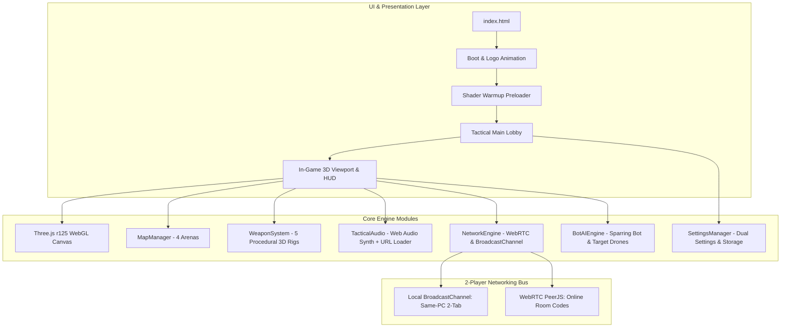

# ⚡ CYBER STRIKE // DUAL ARENA 3D

[](https://threejs.org/)
[](https://www.khronos.org/webgl/)
[](https://developer.mozilla.org/en-US/docs/Web/API/Web_Audio_API)
[](https://webrtc.org/)
[](LICENSE)

> A cutting-edge, zero-dependency browser-based 3D Cyberpunk First-Person Shooter featuring real-time 2-player multiplayer (WebRTC P2P + BroadcastChannel + Smart Sparring Bot), 4 atmospheric handcrafted arenas, 5 tactical sci-fi firearms with procedural 3D models and unique ballistics, an interactive 3D operative customization hub, dual settings consoles, and a hybrid procedural audio engine with custom audio link overrides.

---

## 🎮 Live Demo & Quick Play

- **Instant Local Play**: Open [`index.html`](./index.html) directly in any modern browser (Chrome, Edge, Firefox, Brave, Safari).
- **2-Player Local Testing**: Open `index.html` in two separate browser tabs or side-by-side windows to duel locally with 0ms latency!
- **Online P2P Duels**: Host a match to generate a 6-digit Room Code or share the direct link `index.html?room=XXXXXX` with a friend.

---

## 🌟 Key Highlights & Innovations

### 1. 🌐 Zero-Server 2-Player Networking Engine
- **WebRTC P2P DataChannel**: Direct browser-to-browser UDP-like data synchronization using lightweight cloud signaling (`PeerJS`). No dedicated game servers required.
- **BroadcastChannel API**: Instantaneous zero-latency synchronization between multiple tabs on the same computer—ideal for rapid local testing and presentations.
- **Full 3D Opponent Rendering**: Real-time rendering of your opponent's 3D cybernetic avatar, complete with their customized skin, glowing visor, weapon in hand, nametag billboard, and dynamic health bar.
- **Smart Sparring Bot AI**: Circle-strafing combat bot with variable difficulty (Easy, Medium, Hard, Cyber Demon) ensures solo practice mode is always engaging.

### 2. 🗺️ Four Distinct Thematic Arenas
1. **Sector 07 // Cyber Grid**: Signature synthwave neon grid arena with high-contrast reflective floors, central elevated octagon with rotating power crystal, perimeter sniper decks, and kinetic jump pads.
2. **Solaris Station // Orbital Bay**: Sci-Fi deep space hangar with cosmic starfield, distant nebula sky, metallic catwalks, airlocks, and gravity lift elevators.
3. **Inferno Void // Volcanic Crucible**: Dark volcanic obsidian fortress with lethal molten lava hazards, suspension bridges, and crimson ember atmosphere.
4. **Synth Oasis // Cyber Temple**: Vaporwave dusk sanctuary with monolithic marble pillars, turquoise reflecting pools, holographic torii arches, and elevated shrines.

### 3. 🔫 5-Weapon Tactical Arsenal
Every firearm features a custom-engineered procedural 3D Three.js viewmodel, unique ammo types, recoil impulse, muzzle flash, and ballistics:

| Weapon | Archetype | Ammo Type | Capacity | Mechanics & Visuals |
| :--- | :--- | :--- | :--- | :--- |
| **Plasma Hawk** | Heavy Hand Cannon | Cylinder Cells | 6 / 36 | 46 DMG, rotating cylinder animation, heavy laser punch |
| **ARC-4 Pulse** | Tactical Carbine | Arc Cores | 30 / 120 | 23 DMG, fully automatic, holographic optic, violet tracers |
| **Vortex Breaker** | Scatter Shotgun | Flux Slugs | 8 / 32 | 8 pellets (13 DMG each), pump-action animation, spread cone |
| **Spectre Rail** | Hyper Railgun | HV Batteries | 5 / 20 | 95 DMG (2.5x headshot), right-click ADS sniper zoom scope |
| **Viper-9** | Submachine Gun | Micro Darts | 45 / 180 | 15 DMG, ultra-rapid fire, high mobility, green tracer stream |

### 4. 🎛️ Dual Settings Architecture
- **Global Game Management Console**:
  - Shadow map quality (Off, Medium, High).
  - CRT scanline shader toggle & Bloom glow intensity.
  - FOV slider (65° to 105°).
  - **Custom Audio Link Manager**: Dedicated URL inputs where you can paste custom sound links (MP3/WAV/OGG) for any weapon, reload, dash, hit, or background music with live preview testing!
  - Keybinding remappings.
  - Data management & profile reset protected with confirmation dialogs.
- **Match Play Settings Console**:
  - Game modes: 1v1 Duel, Frag Rush (5, 10, 15, 25 kills), Time Attack.
  - Physics modifiers: Movement speed scale (1.0x to 1.5x), Gravity environment (Earth 1.0G vs Low-G 0.65G), Dash cooldown.
  - Infinite ammo toggle.
  - Sparring Bot AI difficulty selector.

### 5. 🎨 Operative Customization Hub
- Interactive 3D rotatable character model in the main lobby.
- 5 Armor Suit Skins: *Neon Cyber*, *Shadow Ops*, *Arctic Ghost*, *Solar Elite*, and *Toxic Hazard*.
- Customizable tactical visor glow colors (Cyan, Magenta, Gold, Emerald, Purple).
- Player call-sign / name tag editor.

---

## 🏗️ System Architecture



---

## ⌨️ Tactical Controls Cheatsheet

| Action | Primary Key | Secondary / Mouse |
| :--- | :--- | :--- |
| **Move Forward / Backward / Strafe** | `W`, `A`, `S`, `D` | Arrow Keys |
| **Tactical Jump** | `Spacebar` | Jump Pad Collision |
| **Burst Dash** | `Q` | Double-tap `Left Shift` |
| **Momentum Power Slide** | `C` | `Left Control` (while sprinting) |
| **Fire Active Weapon** | `Left Click` | - |
| **Aim-Down-Sights (ADS) Zoom** | `Right Click` | Sniper Scope on Railgun |
| **Reload Weapon** | `R` | - |
| **Weapon Swap (1 - 5)** | `1`, `2`, `3`, `4`, `5` | `Mouse Scroll Wheel` |
| **Pause & Quick Settings Menu** | `Escape` | In-Match Menu |

---

## 🚀 Directory Structure

```
shooting g/
├── index.html                   # Master unified application & flow orchestrator
├── README.md                    # Project documentation & showcase
├── fps-arena.html               # Preserved legacy single-player prototype
├── css/
│   └── game-styles.css          # Cyberpunk HUD styling, scanlines & UI modals
└── js/
    ├── audio-engine.js          # Procedural Web Audio synthesizer + user URL injector
    ├── weapon-system.js         # 5 weapon classes, 3D meshes, ballistics, ADS scope
    ├── map-manager.js           # 4 thematic 3D maps, jump pads & hazard zones
    ├── network-engine.js        # WebRTC P2P DataChannel & local BroadcastChannel
    ├── bot-ai.js                # Sparring combat bot AI & interactive target drones
    └── settings-manager.js      # Global Game Management & Match Play Settings
```

---

## 📄 License

This project is licensed under the [MIT License](LICENSE) - feel free to fork, adapt, and build upon it!
